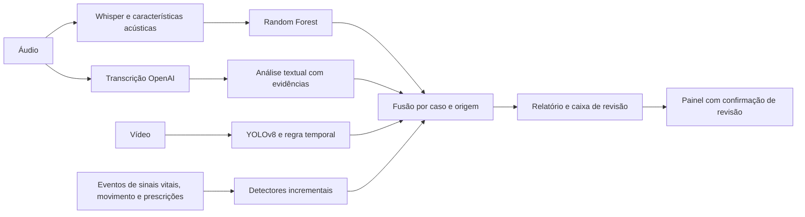

# Monitoramento multimodal em saúde da mulher

**Tech Challenge · Fase 4 · FIAP · IA para Devs**

Protótipo acadêmico que combina voz, eventos de vídeo, texto e séries estruturadas para encaminhar sinais à revisão humana. A entrega reúne as frentes da equipe na branch **Nirton**, com código modular, testes, evidências e relatório em LaTeX.

## Começar pela demonstração

Abra [o notebook de integração](integracao/TechChallengeFase4_integracao.ipynb) no Google Colab e execute em ordem. O modo padrão usa CPU e resultados salvos; não pede chave nem consome créditos de API.

- [Relatório em PDF](output/pdf/relatorio_tecnico_fase4.pdf).
- [Fontes LaTeX e pacote para Overleaf](relatorio/COMO_COMPILAR.md).
- [Resumo da execução](evidence/resumo_execucao.json).
- [Matriz de requisitos](relatorio/matriz_requisitos.md).
- [Roteiro da apresentação do Benicio](relatorio/roteiro_demonstracao.md).

## Fluxo



O Whisper fornece o ritmo utilizado no treinamento do classificador. A transcrição OpenAI alimenta a análise textual separadamente. A fusão preserva a maior prioridade e não transforma falha ou baixa confiança em resultado normal.

## Execuções e alcance

| Frente | Evidência |
|---|---|
| Áudio | Características dos 1.180 WAVs; treinamento por famílias de frases isoladas e reserva cega fora do ajuste final. [Reprodução](evidence/audio_reproducao.json) |
| Amostras novas | Seis WAVs locais, com frases novas e vozes diferentes da voz do dataset. Verificação de software sem rótulos clínicos. [Resultados](evidence/audio_externo.json) |
| Nuvem | Transcrição real dos seis WAVs e análise textual OpenAI, com cache e consumo registrado. [ASR](evidence/audio_openai_transcricoes.json) · [Texto](evidence/openai_validacao.json) |
| Vídeo | Decodificação de 570 quadros recebidos e reprodução de dois eventos pelas detecções salvas. Dois vídeos técnicos novos verificam a regra com detector controlado; não medem YOLO. [Resultados](evidence/video_validacao.json) |
| Monitoramento | 32 pacotes sintéticos, referência anterior congelada, anomalias nas três fontes estruturadas e um alerta. [Resultados](integracao/evidencias/monitoramento_final/monitoramento_resumo.json) |
| Revisão | Painel local testado em navegador, incluindo confirmação e auditoria. [Resultados](evidence/dashboard_validacao.json) |

As métricas antigas de áudio (88%, 92% ou 89%) pertencem a versões ou partições distintas. A execução consolidada possui métricas separadas de validação, teste e reserva cega no relatório e no JSON de reprodução.

## Executar localmente

Python 3.12 foi utilizado na reprodução. A integração e o painel usam somente a biblioteca padrão; áudio e vídeo têm dependências opcionais.

```powershell
python -m venv .venv
.venv\Scripts\python -m pip install -e . pytest
.venv\Scripts\python -m pytest -q
.venv\Scripts\python scripts/run_demo.py --output integracao/evidencias/entrega_final_20261111 --audio-csv audio/evidencias/resultado_audio_externo.csv --audio-filename novo-03.wav --video-json evidence/resultado_video_teste.json --text-json evidence/texto_openai_integracao.json
.venv\Scripts\python -m techchallenge4.dashboard --db integracao/evidencias/entrega_final_20261111/alertas.sqlite3
```

Abra o endereço local exibido. A confirmação de revisão fica registrada na caixa local; não altera tratamentos.

### Monitoramento por chegada de eventos

```powershell
python scripts/run_stream.py --demo --output integracao/evidencias/monitoramento_final
python scripts/run_stream.py --input eventos.jsonl --follow --idle-timeout 5 --max-events 1000
```

O monitor calcula desvios ao receber eventos. A demonstração usa dados sintéticos, não sensores ou pacientes. A latência registrada cobre detecção estruturada, fusão e entrega local; exclui inferência dos modelos e rede. O replay de resultados prontos é outra demonstração.

### Reprodução de áudio e vídeo

Instale [requirements-audio.txt](requirements-audio.txt), execute `git lfs pull` e `python scripts/audio_reproduce.py --device auto`. Os modelos ficam em `artifacts/audio/`; manifestos e métricas ficam em `audio/evidencias/` e `evidence/`. Para um WAV, consulte `python scripts/audio_infer.py --help`.

A reserva cega e as seis gravações externas não entram no ajuste do modelo distribuído. Reclassificar os dados de treinamento não é avaliação independente. Para a nova inferência YOLO, extrair o peso congelado do pacote privado ou reproduzir o treino com o ZIP recebido; veja [DATASETS_E_MODELOS.md](DATASETS_E_MODELOS.md).

### Nuvem e custo

Use o Secret `OPENAI_API_KEY` no Colab ou uma variável de ambiente local. Nunca cole a chave em células ou arquivos publicados. As chamadas começam desligadas. A validação textual tem teto local de US$ 0,10; a transcrição dos seis WAVs, US$ 0,02. Há cache, reserva prévia e limite de chamadas. Esses controles não são limites de cobrança da conta.

O consumo registrado é estimado por tokens/duração, sem consulta à fatura. OpenAI substitui o fornecedor Azure conforme [orientação docente](evidence/orientacao_docente.md). A transcrição Whisper permanece separada da análise textual em nuvem.

## Organização

| Pasta | Conteúdo |
|---|---|
| `src/techchallenge4/` | Contratos, fusão, detectores, nuvem, monitor e painel |
| `audio/`, `video/` | Notebooks, implementação e documentação das frentes |
| `integracao/` | Notebook de entrada e resultados verificados |
| `evidence/` | Resultados consolidados, consumo e proveniência |
| `scripts/`, `tests/` | Reprodução e testes sem chamadas pagas automáticas |
| `relatorio/` | Documentação e fontes LaTeX |
| `dados_privados/`, `artifacts/` | Mídia e modelos locais, preservados no Drive; não publicados automaticamente |

## Limitações e apresentação

- As classes acústicas são emocionais em fala sintética; não validam fadiga, disartria, dificuldade respiratória ou diagnóstico psicológico em pacientes.
- O peso original do Marcelo não foi recuperado. A entrega inclui um **novo YOLOv8s**, com contornos convertidos em caixas e um prefixo inteiro reservado. As métricas novas estão separadas das históricas em `evidence/video_reproducao.json`.
- A montagem de vídeo já foi usada na avaliação da equipe. Recortá-la ou transformá-la não cria uma amostra independente.
- Áudio, vídeo e séries da composição são fontes independentes, sem sincronização de um paciente.
- Os limiares estruturados são demonstrativos, sem validação assistencial. O painel é local, sem conexão hospitalar.
- A gravação final de até 15 minutos, publicação no YouTube/Vimeo e inclusão do link ficam com Benicio/grupo. A equipe deve conferir as imagens de terceiros escolhidas antes da publicação.

## Equipe

| Integrante | RM | Frente |
|---|---|---|
| Benicio Antonio Cardoso | 371527 | Apresentação |
| Marcelo Viana de Araújo | 372707 | Vídeo |
| Nirton Afonso de Oliveira Filho | 370221 | Integração e relatório |
| Valkiria Nonato de Faria | 373256 | Áudio e repositório |

## Referências

FIAP, *IADT - Fase 4 - Tech challenge*, enunciado fornecido pela equipe; [Uterus Dataset v4](https://universe.roboflow.com/machinelearning-yekk6/uterus-qn1he/dataset/4), licença declarada CC BY 4.0; [OpenAI Structured Outputs](https://developers.openai.com/api/docs/guides/structured-outputs); [OpenAI preços](https://developers.openai.com/api/docs/pricing); [Whisper](https://github.com/openai/whisper).


## Auditoria final de conformidade

Consulte [o parecer detalhado](relatorio/auditoria_conformidade.md) antes de gravar. A suíte após a revisão tem **77 testes e 26 subtestes aprovados**. Foram incluídas pressão sistólica/diastólica e validade temporal das fontes. O prazo de 60 segundos é uma configuração operacional da demonstração, não um limite médico. Foram acrescentados análise acústica com referência anterior e fluxo óptico incremental sobre mídias. Os controles físicos foram executados; não se atribui diagnóstico às alterações. O novo detector anatômico tem treino e inferência próprios; as mídias de reserva são montagens, sem validação de cirurgia contínua externa.


## Complementação executável de voz e movimento

[Guia de mídias](integracao/MIDIAS.md): comparação intra-voz de pausas/trechos vocais e fluxo óptico com referência anterior. Os detectores recebem PCM e pixels, sem pesos privados ou respostas injetadas. Oito controles de áudio e dois vídeos geométricos novos foram executados. A montagem da equipe também foi processada; esse detector de movimento não reproduz os achados anatômicos do YOLO.

A reprodução no ritmo original mede extração acústica, inferência visual, fusão e persistência. A espera da janela é de cinco segundos; ASR, nuvem e captura ao vivo ficam fora dessa medição. [Evidência completa](evidence/midias_complementares.json). Sem chamadas pagas adicionais.


## Entrega final e padrão do relatório

- [Dados, pesos e procedimento de reprodução](DATASETS_E_MODELOS.md).
- Novo YOLO: `scripts/video_reproduce.py` e `scripts/video_infer_reserva.py`.
- Entrada de vídeo: `video/TechChallengeFase4_video.ipynb`, com evidências por padrão, sem uso de GPU ou API.
- Modelo emocional congelado incluído em `artifacts/audio/`, com hash e ambiente.
- Relatório no padrão LaTeX fornecido: fonte 12, margens de 2,5 cm, espaçamento 1,5, capa simples com os RMs e links azuis. PDF e Overleaf usam as mesmas fontes/figuras.
- ZIP Uterus v4 recebido e auditado. A exportação oficial exige login; ele está preservado no backup privado da equipe.

A gravação/publicação segue com Benicio. Depois inserir o link em `\linkdovideo` no LaTeX e neste README. Nenhum resultado de controle ou montagem deve ser apresentado como diagnóstico ou desempenho hospitalar.


## Resultado da nova reserva de vídeo

O novo YOLO obteve mAP50 **0,980** no teste de desenvolvimento e **0,613** no outro prefixo reservado. A regra temporal detectou 2 de 3 eventos de referência no teste e 0 de 2 na reserva. A referência deriva das caixas e do tempo construído da montagem, não de complicações médicas. Os limiares não foram alterados após esses resultados. O exemplo positivo usa `resultado_video_teste.json`; a verificação independente do desenvolvimento usa `resultado_video_novo.json` e é preservada separadamente. Ver [relatório](output/pdf/relatorio_tecnico_fase4.pdf) e [evidência](evidence/video_inferencia_nova.json).
