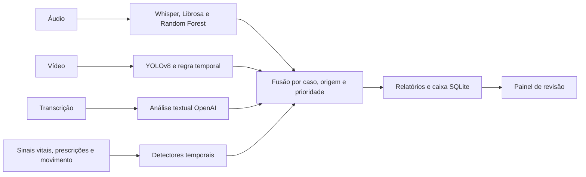

# Monitoramento multimodal em saúde da mulher

Tech Challenge · Fase 4 · FIAP · IA para Devs

Protótipo que combina voz, vídeo, texto e séries temporais para gerar sinais destinados à revisão humana. Os módulos usam contratos comuns, relatórios automáticos e uma caixa de alertas local. O relatório apresenta métodos, resultados e limitações do experimento.

## Entrega e demonstração

| Material | Acesso |
|---|---|
| Aplicação local | [Abrir o painel de consultas](#abrir-o-painel-de-consultas) |
| Relatório final | [PDF](output/pdf/relatorio_tecnico_fase4.pdf) · [Overleaf](relatorio/overleaf_fase4.zip) |
| Notebook de integração | [Notebook executado](integracao/TechChallengeFase4_integracao.ipynb) · [Abrir no Colab](https://colab.research.google.com/github/Val-Faria/TechChallengeFase4/blob/Nirton/integracao/TechChallengeFase4_integracao.ipynb) |
| Análise de áudio | [Notebook executado](audio/notebooks/TechChallengeFase4_audio.ipynb) · [Abrir no Colab](https://colab.research.google.com/github/Val-Faria/TechChallengeFase4/blob/Nirton/audio/notebooks/TechChallengeFase4_audio.ipynb) |
| Análise de vídeo | [Notebook executado](video/TechChallengeFase4_video.ipynb) · [Abrir no Colab](https://colab.research.google.com/github/Val-Faria/TechChallengeFase4/blob/Nirton/video/TechChallengeFase4_video.ipynb) |
| Dados e modelos | [Restauração e reprodução](DATASETS_E_MODELOS.md) |
| Requisitos | [Matriz de atendimento](relatorio/matriz_requisitos.md) |

Os notebooks contêm saídas de execução local, incluindo tabelas, gráficos e painel. Podem ser visualizados sem executar novamente. O áudio recalcula previsões com o modelo congelado; vídeo apresenta medições registradas; integração executa fusão, detectores e persistência. O modo padrão não faz chamadas pagas nem treina modelos.

## Abrir o painel de consultas

Use a branch **Nirton** ou o arquivo `codigo_e_evidencias.zip` da entrega. No computador que vai executar o produto, extraia `artefatos_privados.zip` **dentro da pasta que contém este README**. As pastas `dados_privados` e `artifacts` devem ficar ao lado de `src`. O pacote contém os WAVs, as montagens cirúrgicas, as referências das vozes e o peso YOLO treinado. Os dois ZIPs de datasets são destinados à reprodução do treinamento.

No terminal do PyCharm ou PowerShell, abra essa mesma pasta. Com Python 3.12, prepare o ambiente uma vez:

```powershell
py -3.12 -m venv .venv
.\.venv\Scripts\python.exe -m pip install -e . -r requirements-audio.txt -r requirements-video.txt
```

Para abrir o produto:

```powershell
.\.venv\Scripts\python.exe -m techchallenge4.dashboard
```

Acesse **http://127.0.0.1:8765** e mantenha o terminal aberto. Em **Nova consulta**, escolha a gravação e o vídeo do acervo. Informe a chave no campo protegido e clique em **Processar consulta**. O painel aplica Librosa, Whisper, Random Forest e a comparação de pausas da mesma voz. Executa o YOLO nos quadros da montagem, envia o WAV sintético à API da OpenAI e solicita a análise da transcrição recebida. As séries sintéticas de sinais vitais, movimentação e prescrição alimentam os detectores e compõem a prioridade do caso.

Acompanhe a etapa atual no navegador. Quando aparecer o novo cartão, abra **Ver processamento do caso** para consultar as transcrições, o sentimento, os termos, os intervalos do vídeo e os desvios. Preencha **Revisor**, confirme e recarregue a página para consultar o registro. Relatórios por caso ficam em `integracao/saidas/painel/consultas/` e a caixa de revisão em `integracao/saidas/painel/alertas.sqlite3`. As pastas são criadas pelo sistema.

A chave fica em memória durante o pedido. Cada clique aceito inicia uma transcrição e, se ela for concluída, uma análise textual. O aplicativo mantém um registro local do consumo estimado por serviço. O primeiro uso do Whisper pode baixar o modelo. A execução local funciona em CPU. Para encerrar, pressione **Ctrl+C** no terminal.

## Notebooks e experimentos

Para executar e salvar as saídas dos três notebooks:

```powershell
python -m pip install -r requirements-notebooks.txt
python scripts/executar_notebooks.py
```

## Fluxo e organização



| Diretório | Responsabilidade |
|---|---|
| `src/techchallenge4/` | Contratos, fusão, detectores, nuvem, entrega, painel e suporte aos notebooks |
| `audio/`, `video/` | Notebooks, regras visuais e documentação das modalidades |
| `integracao/` | Demonstração integrada e resultados de referência |
| `scripts/` | Extração, avaliação, reprodução e geração de artefatos |
| `tests/` | Regressões de contratos, regras, cache, orçamento e persistência |
| `evidence/`, `artifacts/` | Métricas, partições, proveniência e manifestos de modelos |
| `relatorio/` | Fonte LaTeX, Overleaf e matriz de requisitos |
| `output/pdf/` | Relatório final compilado |

A execução de referência está em `integracao/evidencias/revisao_final_20261111/`. Os controles externos estão em `revisao_video_externo_20261111/`; o monitor estruturado, em `monitoramento_final/`. Resultados anteriores ficam em `integracao/evidencias/historico/` e não substituem a avaliação atual.

## Resultados e alcance

- **Áudio:** 1.180 gravações sintéticas, partições isoladas por família de frase. A reserva tem acurácia de 88,33%. As seis falas externas ficaram abaixo do limiar de confiança e são inconclusivas.
- **Vídeo:** novo YOLOv8s, mAP50 de 0,980 no teste e 0,613 na reserva de origem. A regra pareou 2/3 intervalos derivados de caixas no teste e 0/2 na reserva. Ausência de caixa não confirma ausência anatômica; a divergência exige revisão das anotações e das detecções.
- **Nuvem:** transcrição e análise textual reais da OpenAI, com resultados salvos, negação/contexto e consumo registrado. A substituição do Azure foi [autorizada pelo professor](evidence/orientacao_docente.md).
- **Alertas:** monitoramento incremental, caixa SQLite e confirmação auditável. Baixa confiança ou cobertura parcial não são convertidas em normalidade.

O conjunto não representa pacientes pareados. Séries estruturadas e controles físicos são sintéticos. A proteção visual removeu um falso alerta sobre ilustração em uma fonte didática externa; não demonstra detecção clínica confiável. [Detalhes da avaliação de vídeo](relatorio/revisao_video.md).

## Reprodução e credenciais

O [guia de dados e modelos](DATASETS_E_MODELOS.md) contém hashes, fontes e caminhos de restauração. Áudio, vídeo e análise de mídias têm dependências opcionais próprias. Reproduções de treinamento são experimentos separados da visualização dos notebooks.

`OPENAI_API_KEY` é necessária somente para novas chamadas; no painel, informe a chave no formulário. Para experimentos pelo notebook ou terminal, use o mecanismo indicado em cada componente. Há cache e controle local de consumo, que não substituem os limites de cobrança da conta. Credenciais e mídias privadas não integram os pacotes públicos. Ao usar GPU opcional no Colab, salvar os artefatos e desconectar/excluir o ambiente ao terminar.

## Equipe

| Integrante | RM |
|---|---|
| Marcelo Viana de Araújo | 372707 |
| Nirton Afonso de Oliveira Filho | 370221 |
| Valkiria Nonato de Faria | 373256 |
| Benicio Antonio Cardoso | 371527 |
