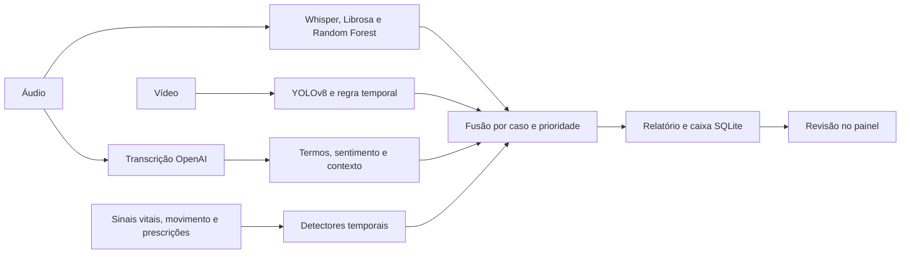

# Monitoramento multimodal em saúde da mulher

Tech Challenge · Fase 4 · FIAP · IA para Devs

Aplicação que reúne análise de voz, vídeo cirúrgico e texto em nuvem com o acompanhamento de sinais vitais, movimentação e prescrições. Cada consulta produz evidências por modalidade, prioridade, relatório automático e registro de revisão.

## Executar a aplicação

Requisitos de instalação: Python 3.12, Git e Git LFS. Os áudios, vídeos, referências e modelos usados pelo painel estão incluídos no repositório.

Na pasta do projeto, prepare o ambiente:

```powershell
git lfs install
git lfs pull
py -3.12 -m venv .venv
.\.venv\Scripts\python.exe -m pip install -e . -r requirements-audio.txt -r requirements-video.txt
```

Inicie a aplicação:

```powershell
.\.venv\Scripts\python.exe -m techchallenge4.dashboard
```

Abra **http://127.0.0.1:8765** no navegador. Mantenha o terminal aberto durante o uso e pressione **Ctrl+C** para encerrar. O processamento funciona em CPU. O primeiro uso baixa o modelo Whisper pela internet.

## Processar uma consulta

1. Em **Nova consulta**, escolha cada mídia do acervo ou selecione **Enviar do dispositivo**. Os controles permitem ouvir o áudio e assistir ao vídeo antes de iniciar.
2. Cole sua chave no campo **Chave da API OpenAI** e clique em **Processar consulta**.
3. Acompanhe as etapas. Durante a análise visual, o painel exibe os quadros efetivamente processados pelo detector, as caixas e a contagem de quadros.
4. No cartão do caso, abra **Ver processamento do caso** para consultar transcrições, características da voz, termos críticos, sentimento, intervalos visuais e desvios das séries. O vídeo exibido nessa saída contém as marcações produzidas pelo detector e fica salvo em WebM.
5. Preencha **Revisor** e clique em **Confirmar revisão**. O registro permanece disponível ao recarregar a página.

Os envios aceitam áudio WAV PCM16 de até 60 segundos e 25 MB, além de vídeo MP4, WebM, AVI ou MOV de até cinco minutos e 100 MB. É possível combinar uma mídia do dispositivo com outra do acervo. Os arquivos enviados e o vídeo anotado são preservados na pasta local da consulta. A comparação de pausas em uma voz enviada fica inconclusiva quando falta uma referência anterior dessa mesma voz.

A chave é criada na [plataforma da OpenAI](https://platform.openai.com/api-keys) e deve ter acesso aos modelos `gpt-4o-mini-transcribe` e `gpt-4o-mini`, com créditos na conta da API. Cada consulta envia o WAV selecionado para transcrição e depois o texto para análise. O vídeo é processado localmente. A chave permanece em memória durante a solicitação. O campo é mascarado e a credencial fica fora do versionamento e dos relatórios.

O aplicativo registra o consumo estimado e aplica limites locais por serviço. Os limites de cobrança da conta devem ser consultados na plataforma. As saídas ficam em `integracao/saidas/painel/`, incluindo relatórios por consulta e o banco `alertas.sqlite3`.

## Dados e modelos

| Caminho | Conteúdo |
|---|---|
| `dados/audio/` | Seis gravações sintéticas e manifesto de origem |
| `dados/video/` | Duas montagens cirúrgicas usadas na inferência |
| `dados/video/visualizacao/` | Cópias WebM para reprodução no navegador |
| `dados/referencias/` | Referências anteriores das vozes sintéticas |
| `artifacts/audio/` | Classificador Random Forest, características e manifesto |
| `artifacts/video/` | Peso YOLOv8s, manifesto e referência visual |
| `audio/datasets/` | Corpus de treinamento de áudio, em Git LFS |
| `video/datasets/` | Exportação Uterus v4, em Git LFS |

As instruções de reprodução estão em [Dados e modelos](DATASETS_E_MODELOS.md). A origem, a licença e as transformações das mídias constam em [Atribuição dos dados](dados/README.md).

## Fluxo multimodal



## Relatório e notebooks

| Material | Acesso |
|---|---|
| Relatório técnico | [PDF](output/pdf/relatorio_tecnico_fase4.pdf) · [Overleaf](relatorio/overleaf_fase4.zip) |
| Integração | [Notebook com saídas](integracao/TechChallengeFase4_integracao.ipynb) |
| Áudio | [Notebook com saídas](audio/notebooks/TechChallengeFase4_audio.ipynb) |
| Vídeo | [Notebook com saídas](video/TechChallengeFase4_video.ipynb) |
| Requisitos | [Matriz de atendimento](relatorio/matriz_requisitos.md) |

Os notebooks documentam os experimentos e as avaliações. Para recalcular e salvar suas saídas, instale `requirements-notebooks.txt` e execute `python scripts/executar_notebooks.py`.

## Resultados e alcance

O classificador de voz foi avaliado em 1.180 gravações sintéticas, com separação por família de frase. A acurácia na reserva foi de 88,33%. As seis falas externas ficaram abaixo do limiar de confiança de 0,70.

O YOLOv8s obteve mAP50 de 0,980 no teste e 0,613 na reserva de origem. A regra temporal pareou 2/3 intervalos de referência no teste e 0/2 na reserva. Os intervalos são derivados das anotações de objetos. A divergência requer revisão das anotações e detecções. [Avaliação de vídeo](relatorio/revisao_video.md).

A transcrição e a análise textual usam a OpenAI, conforme [orientação docente](evidence/orientacao_docente.md). As fontes do experimento são independentes. As séries estruturadas são sintéticas e os alertas requerem avaliação humana. O relatório registra as limitações clínicas do protótipo.

## Organização

`src/techchallenge4/` contém o processamento integrado, a nuvem, os detectores, a persistência e o painel. `video/` e `audio/` reúnem os componentes e experimentos de cada modalidade. `scripts/` oferece entradas para reprodução. `tests/` contém a suíte de software. `evidence/` preserva os resultados experimentais e `relatorio/` contém as fontes LaTeX.

## Equipe

| Integrante | RM |
|---|---|
| Marcelo Viana de Araújo | 372707 |
| Nirton Afonso de Oliveira Filho | 370221 |
| Valkiria Nonato de Faria | 373256 |
| Benicio Antonio Cardoso | 371527 |
