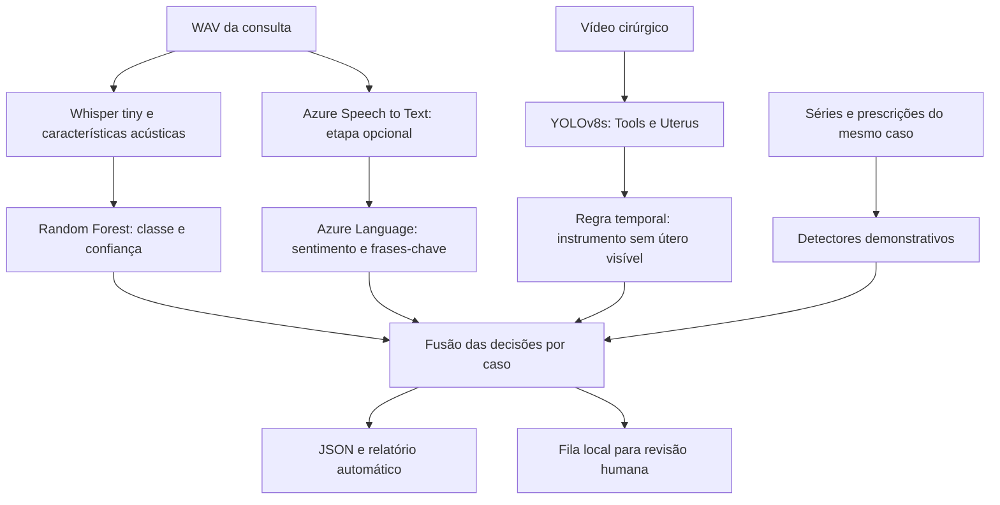

# Relatório técnico - Monitoramento multimodal em saúde da mulher
## Tech Challenge - Pós Tech FIAP - IA para Devs - Fase 4

**Equipe**

| Integrante | RM | Responsabilidade combinada |
|---|---|---|
| Benicio Antonio Cardoso | 371527 | Gravação e edição do vídeo |
| Marcelo Viana de Araújo | 372707 | YOLOv8 e alertas de vídeo |
| Nirton Afonso de Oliveira Filho | 370221 | Integração e relatório técnico |
| Valkiria Nonato de Faria | 373256 | Repositório e classificação de áudio |

**Base dos modelos:** Val-Faria/TechChallengeFase4, commit `8b6a06cd1456ade14b18ef0aa8096e49801f62fb`, consultado em 02/11/2026.

**Validação da integração:** demonstração executada e contratos verificados. Chamadas Azure reais e inferência YOLO com os pesos da equipe permanecem pendentes.

## 1. Problema e objetivo

O enunciado propõe ampliar um assistente clínico para analisar dados de texto, áudio e vídeo, detectar anomalias e gerar alertas à equipe. A solução do grupo recorta esse problema para vídeos de laparoscopia ginecológica e características acústicas de falas sintéticas.

A integração reúne as decisões de cada frente, mantém a origem das evidências e gera um resultado único em JSON, um relatório automático e uma fila local de revisão. Também oferece adaptadores para Azure Speech to Text e Azure Text Analytics e funções demonstrativas para séries de sinais vitais, movimentação e evolução de prescrições.

O protótipo processa arquivos em lote no Google Colab. A fila local representa o ponto de entrega para uma futura interface da equipe; não comprova envio a um hospital nem funcionamento contínuo em tempo real.

## 2. Fluxo multimodal

A integração oferece duas formas de execução:

1. **Consumir resultados existentes:** uma linha explicitamente escolhida do CSV de áudio e o JSON de vídeo gerado pelo Marcelo.
2. **Executar modelos em arquivos:** classificar um WAV com o modelo salvo e analisar um vídeo com os pesos YOLO fornecidos.

O pareamento é explícito por identificador de caso. Os datasets de fala sintética e cirurgia são independentes. Combiná-los demonstra a integração de software, mas não demonstra associação temporal ou clínica. O protótipo não alinha janelas entre áudio e vídeo.

A transcrição Azure segue como evidência textual adicional. O ritmo usado pelo Random Forest continua sendo calculado com Whisper, como no treinamento, para evitar uma troca não avaliada na representação de entrada.

## 3. Dados e rastreabilidade

### 3.1 Áudio

O notebook da equipe gera falas com a voz pt-BR-FranciscaNeural do Azure Speech. São utilizadas 20 frases-base, prefixos e configurações de ritmo, tom e volume para três classes: ansiedade_hesitacao, neutro e tristeza. A geração nominal produz 300 áudios-base, com quatro versões de cada: original, lento, rápido e ruído.

A documentação descreve 1.200 arquivos. A auditoria do ZIP efetivamente versionado via Git LFS encontrou:

| Evidência | Quantidade observada |
|---|---:|
| WAVs no ZIP | 1.180 |
| Linhas do metadata.csv no ZIP | 1.180 |
| Gravações originais distintas no metadata | 295 |
| Ansiedade/hesitação no ZIP | 380 |
| Neutro no ZIP | 400 |
| Tristeza no ZIP | 400 |
| Linhas de resultado_audio.csv no Drive | 1.200 |
| Nomes do CSV sem WAV no ZIP | 20 |

Os 20 nomes ausentes correspondem às quatro variações dos índices 045, 057, 064, 075 e 081 de ansiedade_hesitacao. O metadata do ZIP é consistente com seus 1.180 WAVs; a divergência ocorre em relação ao CSV e ao total nominal. Não se pode concluir a causa dessa diferença sem confirmação da equipe.

As classes previstas no CSV são: 395 ansiedade_hesitacao, 405 neutro e 400 tristeza. Esses valores são contagens de **predições**, não métricas de avaliação.

A pasta de Drive informada contém o modelo treinado e o CSV de predições. O dataset de áudio está no Git LFS, com tamanho de 100.505.224 bytes.

### 3.2 Vídeo

Segundo a documentação e a seção de vídeo do grupo, foi usado o Uterus Dataset v4, publicado no Roboflow Universe sob licença CC BY 4.0, com classes Tools e Uterus. A divisão declarada é 1.197 imagens de treino, incluindo versões aumentadas, 114 de validação e 57 de teste. A biblioteca utilizou 56 imagens de teste na avaliação relatada.

O detector é YOLOv8s, ajustado a partir dos pesos COCO, com resolução de 416 × 416, até 80 épocas, batch 16 e parada antecipada com paciência 20, em GPU T4 no Colab.

Os pesos best_uterus_tools_v4.pt, o vídeo usado no exemplo e seus JSONs gerados não foram encontrados nos links disponibilizados. Por isso, as métricas e os eventos apresentados nesta seção são atribuídos à frente de vídeo e não foram reproduzidos na verificação da integração.

### 3.3 Novas fontes estruturadas

Não foram encontrados dados de sinais vitais, histórico de prescrições ou séries de movimentação no repositório. A extensão implementada usa dados sintéticos claramente identificados e aceita dados estruturados de um único caso, com timestamps ordenados e fuso horário.

## 4. Modelos e regras

### 4.1 Classificação de áudio

O pipeline da equipe usa Whisper tiny para transcrição em português e librosa para seis características:

| Característica | Cálculo |
|---|---|
| duracao | Duração do áudio em segundos |
| energia_media | Média da energia RMS |
| proporcao_pausas | Fração fora dos intervalos sonoros, top_db=30 |
| ritmo_palavras_minuto | Quantidade de palavras transcritas dividida pela duração em minutos |
| tom_medio_hz | Média do F0 válido obtido por pYIN |
| tom_desvio_hz | Desvio padrão do F0 válido |

O áudio é carregado como mono a 16 kHz. O classificador é RandomForestClassifier, com 200 árvores, random_state=42 e class_weight=balanced.

A avaliação do notebook utiliza GroupShuffleSplit com 20% para teste. Os grupos são os valores de grupo_original, derivados do nome da gravação original. Isso separa as variações aumentadas de cada gravação. **Não garante que frases-base iguais estejam ausentes entre treino e teste**, pois as frases são reutilizadas em diferentes gravações e classes.

Após a avaliação, o notebook treina o modelo final em todos os dados. Consequentemente, classificar novamente o próprio conjunto com esse modelo não constitui um teste independente.

O artefato salvo contém modelo e colunas. Foi identificado scikit-learn 1.6.1 no arquivo. A integração verifica versão, hash, esquema e classes antes do uso. Arquivos vazios, silenciosos, muito curtos ou sem transcrição produzem resultado inconclusivo.

### 4.2 Alerta de vídeo

A regra da equipe gera evento quando há instrumento com confiança de pelo menos 0,4 e ausência de útero com confiança mínima de 0,6, por pelo menos 5 segundos. São toleradas interrupções curtas, de até 1 segundo.

O limiar de útero 0,6 foi escolhido na validação para reduzir o efeito de falsos positivos de útero que ocultavam eventos. A prioridade operacional segue a regra original:

| Prioridade | Critério |
|---|---|
| baixo | Evento com pelo menos 5 s |
| medio | Maior evento com pelo menos 10 s |
| alto | Maior evento com pelo menos 15 s ou ao menos três eventos |
| nenhum | Sem evento que satisfaça o critério |

A adaptação em notebook mantém o contrato e inclui validação de abertura/decodificação, fechamento de recursos, FPS de saída coerente com a amostragem efetiva e limitação do evento ao final do vídeo. Essas mudanças de integração não receberam nova avaliação de mAP ou recall.

A confiança de um evento é derivada da detecção do instrumento. Não mede a probabilidade de uma complicação cirúrgica.

### 4.3 Azure Speech to Text e Azure Text Analytics

O enunciado exige transcrição com Azure Speech to Text e identificação de termos/sentimentos com Azure Text Analytics. A síntese de voz Azure já realizada pela equipe e o Whisper não demonstram, por si, essas duas exigências.

Foram preparados os adaptadores de reconhecimento contínuo de WAV e de análise de sentimento/frases-chave pelo cliente Azure Text Analytics. Os Secrets esperados são SPEECH_KEY, SPEECH_REGION, AZURE_LANGUAGE_KEY e AZURE_LANGUAGE_ENDPOINT.

O adaptador textual seleciona menções de um vocabulário demonstrativo entre as frases-chave retornadas pelo serviço. Pode solicitar revisão por menções selecionadas ou sentimento negativo com score elevado. Essa regra não resolve negação nem contexto clínico e requer revisão humana. Textos acima do limite local são rejeitados sem truncamento.

**Estado:** implementação preparada e contrato testado com cliente controlado. Não houve chamada aos serviços reais por ausência de recursos e credenciais identificados.

### 4.4 Séries e evolução de prescrições

Para séries de sinais vitais e movimento, a extensão calcula a mediana e a escala robusta 1,4826 × MAD em um histórico anterior independente. Um desvio de pelo menos seis escalas robustas gera uma evidência. Histórico insuficiente ou sem dispersão gera resultado inconclusivo. O limiar é demonstrativo e não corresponde a uma faixa clínica.

Para prescrições, compara registros sucessivos do mesmo medicamento. Mudanças de via, unidade ou intervalo são destacadas para revisão. A variação relativa de dose é calculada somente quando unidade e via são iguais; o limiar de 50% também é demonstrativo. O sistema não recomenda nem executa mudanças de tratamento.

Essas funções cobrem os pontos de integração dos três tipos de fonte, mas sua demonstração sintética não comprova desempenho em dados assistenciais.

## 5. Contrato de integração e resposta

A função combinar_audio_video aceita a tupla de áudio ou uma linha do CSV e o dicionário de vídeo da equipe. O resultado inclui:

| Campo | Significado |
|---|---|
| id_caso | Identificador explícito do caso |
| id_resultado | Identificador derivado das evidências e do pareamento |
| alerta | Presença de algum sinal válido nas fontes |
| nivel | Maior prioridade operacional entre os sinais |
| requer_revisao | Verdadeiro para sinal ou fonte inconclusiva |
| status | completo ou incompleto em relação às fontes consideradas |
| simulado | Marca entradas simuladas e demonstrações |
| fontes | Evidências e estado individual de cada modalidade |
| fontes_inconclusivas | Fontes ausentes, com falha ou baixa confiança |
| entrega | Registro em fila local, sem confirmação externa |

A regra usa OR entre sinais válidos e preserva o maior nível. Um áudio neutro não cancela um alerta de vídeo. As confianças de diferentes modelos não são somadas nem promediadas.

O limiar acústico 0,70 é uma escolha de demonstração da integração e não foi calibrado clinicamente. Abaixo dele, inclusive para a classe neutro, o áudio é inconclusivo. Dados inválidos são rejeitados; falhas operacionais não geram uma classe neutra artificial.

O termo completo descreve a cobertura das fontes esperadas no caso, não o atendimento integral ao enunciado nem uma conclusão médica.

O notebook salva resultados.jsonl, fila_revisao.jsonl, resumo.csv e um JSON/Markdown por caso. Repetir a exportação do mesmo lote substitui o snapshot e evita duplicação de linhas. A fila inclui os resultados que pedem revisão, inclusive por fonte ausente. Não foi implementado envio de e-mail, WhatsApp ou outro canal externo.

## 6. Resultados e exemplos

### 6.1 Áudio: resultados registrados pela equipe

Há divergência entre o README e a saída persistida no notebook consultado:

| Fonte consultada | Acurácia registrada |
|---|---:|
| README do commit-base consultado | 0,88 |
| Saída da célula de avaliação do notebook de áudio | 0,92 |

A saída do notebook registra 240 exemplos de teste e as seguintes métricas arredondadas:

| Classe | Precisão | Recall | F1 | Suporte |
|---|---:|---:|---:|---:|
| ansiedade_hesitacao | 0,93 | 0,84 | 0,88 | 88 |
| neutro | 0,81 | 0,91 | 0,85 | 64 |
| tristeza | 1,00 | 1,00 | 1,00 | 88 |

Esses números foram lidos da saída salva, sem novo treinamento ou reprodução da avaliação. O README desta branch referencia o valor salvo no notebook e mantém registrada a necessidade de consolidação. A equipe deve executar novamente a avaliação na versão confirmada do dataset e consolidar a métrica final.

### 6.2 Vídeo: resultados registrados pelo Marcelo

| Detector no teste | mAP50 | mAP50-95 |
|---|---:|---:|
| Geral | 0,928 | 0,636 |
| Tools | 0,906 | 0,538 |
| Uterus | 0,950 | 0,734 |

O alerta com conf_area=0,6 teve precisão 1,00 e recall 0,72 no teste relatado. O ensaio foi feito em montagem de imagens, com 2 segundos por imagem, e não em uma cirurgia contínua.

A avaliação do alerta contabiliza quadros sinalizados em relação às anotações e aos quadros pertencentes a trechos suficientemente longos. Portanto, o recall divulgado não deve ser descrito como taxa de detecção de complicações nem como percentual de cirurgias corretamente avaliadas.

Na demonstração registrada pela equipe, os eventos foram 76-82 s e 84-114 s, com prioridade alta. Esses eventos são citados da seção de vídeo; o vídeo e os arquivos de evidência não foram reproduzidos nesta verificação.

### 6.3 Integração: resultados da verificação

O notebook foi validado como .ipynb e executado integralmente com os controles padrão. Os testes de cada serviço têm controles independentes da integração final. **49 verificações passaram**, cobrindo fusão, valores inválidos, baixa confiança, fonte ausente, intervalos, persistência, pareamento e o adaptador textual com cliente Azure controlado.

Os quatro exemplos base, todos simulados, produziram:

| Cenário | Entradas | Saída esperada e obtida |
|---|---|---|
| demo-01 | Áudio neutro confiável; vídeo sem sinal | Sem alerta; cobertura completa |
| demo-02 | Ansiedade/hesitação com 0,81; vídeo sem sinal | Alerta de prioridade média |
| demo-03 | Áudio neutro; evento de vídeo de 18 s | Alerta alto preservado |
| demo-04 | Áudio ausente; vídeo sem sinal | Sem sinal positivo; cobertura incompleta e revisão necessária |

O exemplo estendido usa apenas séries e prescrições sintéticas. Detecta desvios estatísticos e alteração de dose demonstrativa. A fonte texto_azure permanece explicitamente indisponível até a chamada real.

As 1.200 linhas do CSV compartilhado passaram pela validação de classe e intervalo de confiança. O modelo real foi carregado com scikit-learn 1.6.1. A extração de características de WAVs e predict_proba foram verificados com texto de referência do metadata injetado no lugar da transcrição. Isso verifica o extrator e o classificador, mas não é execução do Whisper nem avaliação independente do pipeline de áudio.

A evidência detalhada está em integracao/evidencias/auditoria_audio.json e integracao/evidencias/validacao_contratos.json. Não foi calculada uma métrica multimodal global, pois não existe conjunto pareado e rotulado que a sustente.

## 7. Limitações e cobertura do enunciado

- Áudios sintéticos de uma única voz e rótulos construídos por parâmetros de prosódia não demonstram reconhecimento de fadiga, disartria ou dificuldade respiratória em pacientes reais.
- A divisão por gravação original protege contra compartilhamento de suas variações, mas não contra repetição de frases-base nem de locutor.
- O ZIP e o CSV têm quantidades diferentes; isso impede reprodução inequívoca do treinamento declarado até a versão ser consolidada.
- O modelo final foi treinado em todos os dados; seu CSV não é uma avaliação de teste.
- A frente de vídeo informa dataset pequeno, origem das imagens incompletamente documentada e possível proximidade de quadros entre conjuntos. Isso pode tornar as métricas otimistas.
- As imagens de vídeo avaliadas foram montadas em sequência; o contexto temporal não representa uma cirurgia contínua.
- Perda de visualização do útero é um indicador heurístico; pode ocorrer em situações normais.
- As fontes de áudio e vídeo disponíveis não são pareadas por paciente, tempo ou procedimento.
- Os adaptadores Azure foram preparados, mas não validados contra os serviços reais.
- Sinais vitais, prescrições e movimentação têm apenas exemplos sintéticos nesta entrega.
- Não houve validação de latência, processamento contínuo, autenticação hospitalar nem confirmação de entrega externa.
- O código da Fase 3 não está no repositório consultado; a continuidade com aquele sistema não foi verificada.

A matriz anexa distingue implementação, demonstração e validação pendente. Nenhuma dessas pendências deve ser apresentada como concluída na gravação.

## 8. Reprodução no Google Colab

Abra integracao/TechChallengeFase4_integracao.ipynb e execute as células na ordem. Com as opções padrão, a demonstração e os testes não exigem GPU nem acesso à nuvem.

Para integrar o material do grupo sem retreinar, envie resultado_audio.csv e o JSON de vídeo, ajuste os caminhos, escolha o nome exato do áudio e confirme o pareamento do caso. Para inferência direta, forneça o modelo de áudio, um WAV, os pesos YOLO e o vídeo. O notebook contém o código necessário em células .ipynb.

O modelo compartilhado exige scikit-learn 1.6.1. O ambiente de inferência deve ser compatível com a versão de Python e as dependências do treinamento; as versões verificadas localmente estão no arquivo de evidências. Divergência de versão ou hash interrompe o carregamento para revisão.

As chamadas Azure dependem de recursos provisionados, endpoint/região e Secrets com acesso habilitado no Colab. Para testar apenas os serviços, ative EXECUTAR_AZURE e mantenha EXECUTAR_INTEGRACAO desligado. Depois da configuração, execute o WAV de exemplo e registre as saídas reais para atualizar este relatório.

## 9. Etapas pendentes

1. Consolidar a versão do dataset e a métrica de áudio.
2. Receber os artefatos de vídeo e executar um exemplo integrado com origem claramente documentada.
3. Provisionar/localizar os recursos Azure e registrar uma execução real de Speech to Text e Language.
4. Substituir ou complementar os exemplos sintéticos de séries e prescrições com dados apropriados e avaliação documentada.
5. Revisar a resposta final do alerta e atualizar a matriz de requisitos.
6. Gravar o vídeo de até 15 minutos, publicar conforme o enunciado e inserir o link final no repositório.

## 10. Fontes e materiais consultados

- FIAP. **IADT - Fase 4 - Tech challenge.pdf**, páginas 2-4: objetivos, requisitos e entregáveis.
- FIAP. **4IADT - Fase 4 - Capítulo Projeto.pdf**: organização das disciplinas.
- FIAP. **Aula 03.pdf**: atividades e reconhecimento de ações em vídeos.
- FIAP. **Aula 04.pdf**: transcrição e processamento de áudio.
- FIAP. **Aula 05.pdf**: classificação, preparação de dados e avaliação.
- FIAP. **Aula 05 - Integração e Automação com a API da OpenAI.pdf**: composição de fluxos por APIs.
- [Repositório e README na versão consultada](https://github.com/Val-Faria/TechChallengeFase4/tree/8b6a06cd1456ade14b18ef0aa8096e49801f62fb).
- [Notebook de áudio da equipe](https://github.com/Val-Faria/TechChallengeFase4/blob/8b6a06cd1456ade14b18ef0aa8096e49801f62fb/audio/notebooks/TechChallengeFase4_audio.ipynb).
- [Seção de vídeo da equipe](https://github.com/Val-Faria/TechChallengeFase4/blob/8b6a06cd1456ade14b18ef0aa8096e49801f62fb/relatorio/secao_video.md).
- [Entrega de áudio no Drive](https://drive.google.com/drive/folders/1CepZNFDXamN3hVWopqd7xWCnD5OiOLJ8).
- [Microsoft Learn: Speech to Text](https://learn.microsoft.com/en-us/azure/ai-services/speech-service/get-started-speech-to-text?pivots=programming-language-python).
- [Microsoft Learn: cliente Text Analytics para Python](https://learn.microsoft.com/en-us/python/api/overview/azure/ai-textanalytics-readme?view=azure-python).
- [Scikit-learn: persistência e compatibilidade de modelos](https://scikit-learn.org/stable/model_persistence.html).
- [Uterus Dataset v4](https://universe.roboflow.com/machinelearning-yekk6/uterus-qn1he/dataset/4).
